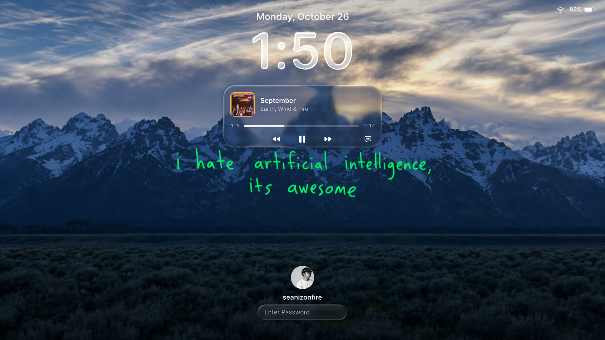
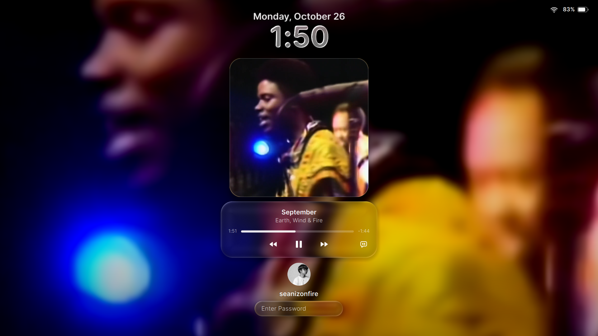
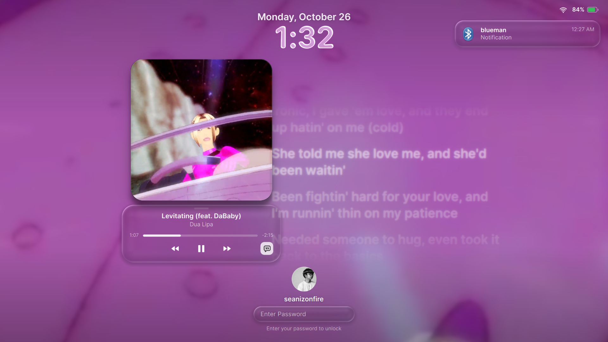

# 🍎 macOS Liquid Glass Desktop Dotfiles

An aesthetic, highly polished Linux desktop environment inspired by macOS 26/27 Liquid Glass, built on **Hyprland**, **Waybar**, and **Quickshell**.

Features a custom **MacLock** lockscreen with **Spotify Canvas looping video playback**, dynamic corner masking, full-screen ambient blurred background, synchronized lyrics, and **SpotX-Bash** integration.

---

## 📸 Screenshots

| Default Lockscreen (Static Cover Bubble) | Enlarged Artwork (Animated Spotify Canvas) | Side-by-Side Lyrics View |
| :---: | :---: | :---: |
|  |  |  |

---

## ✨ Features

- **Window Management**: [Hyprland](https://hyprland.org/) Wayland compositor with fluid animations, custom window rules, and keybindings.
- **Top Bar**: [Waybar](https://github.com/Alexays/Waybar) featuring a custom Debian launcher icon, active workspaces, clock, and hardware monitors.
- **Desktop & Dock Suite (Quickshell MacShell)**:
  - Liquid Glass dock with magnification and active app indicators.
  - macOS-style Control Center with quick toggles (Wi-Fi, Bluetooth, Night Shift, Audio, DND).
  - Native volume and brightness OSD overlays.
- **MacLock Lock Screen**:
  - **Spotify Canvas Looping Video**: Fetches and plays vertical looping Canvas videos inside the album art card.
  - **Dynamic Corner Masking**: Interpolates from `11px` in the compact bubble to `28px` in the expanded artwork card.
  - **Ambient Ambient Video Blur**: Full-screen ambient blurred video glow on the lock screen backdrop.
  - **Smart Presentation**: Shows clean static album art in the compact bubble, and transitions to looping video when clicked/enlarged.
  - **Synchronized Lyrics**: Live synced karaoke scrolling lyrics (NetEase, LRCLIB, Genius).
  - **Lifecycle Aware**: Pauses automatically when music is paused or screen is unlocked.
- **Spotify + SpotX-Bash**:
  - Native Wayland launcher wrapper with Ozone flags (`--enable-features=UseOzonePlatform --ozone-platform=wayland`).
  - Bundled SpotX-Bash patcher for audio/banner adblocking and a clean UI.
- **Automated Cache Maintenance**:
  - Built-in `systemd` user timer (`maclock-clear-cache.timer`) automatically cleans expired Canvas MP4s and cached lyrics on the last day of every month.

---

## 🚀 Quick Start

### 1. Clone Repository
```bash
git clone https://github.com/penOnFire/dotfiles.git ~/dotfiles
cd ~/dotfiles
```

### 2. Deploy Configuration
Run the automated installer to symlink configs and activate systemd timers:
```bash
./install.sh
```

### 3. Setup Spotify & SpotX-Bash
Run the Spotify helper script to configure the Wayland wrapper and patch Spotify:
```bash
./spotify/install-spotify.sh
```

---

## 🎬 Activating Spotify Canvas Video Playback

Because Spotify's Canvas videos are queried securely through Spotify's internal client API, MacLock uses your web player session cookie (`sp_dc`) to authenticate requests.

> [!NOTE]
> Your `sp_dc` cookie stays strictly local in `~/.config/maclock/sp_dc` and is **never** pushed to Git (protected by `.gitignore`).

1. Open [open.spotify.com](https://open.spotify.com) in your web browser (Chrome, Chromium, Firefox, etc.) and log in.
2. Press <kbd>F12</kbd> (Developer Tools) -> navigate to:
   - **Chrome / Chromium / Edge / Brave**: `Application` tab -> `Cookies` -> `https://open.spotify.com`
   - **Firefox**: `Storage` tab -> `Cookies` -> `https://open.spotify.com`
3. Locate the cookie named **`sp_dc`** and copy its value.
4. Save it into `~/.config/maclock/sp_dc`:
   ```bash
   mkdir -p ~/.config/maclock
   echo "PASTE_YOUR_SP_DC_COOKIE_HERE" > ~/.config/maclock/sp_dc
   chmod 600 ~/.config/maclock/sp_dc
   ```

Now, when locking your screen (`Super + L`) or previewing with `MACLOCK_PREVIEW=1 qs -c MacLock`, supported Spotify songs will loop crisp Canvas videos!

---

## 🧹 Automated Cache Cleaning

MacLock automatically caches downloaded `.mp4` video loops in `~/.cache/maclock/canvas/`. To prevent disk space buildup, an automated systemd timer clears the cache at the end of every month:

- **Timer**: `~/.config/systemd/user/maclock-clear-cache.timer`
- **Schedule**: Last day of each month at 23:59 (`*-*~01 23:59:00`)
- **Manual Trigger**:
  ```bash
  maclock-clear-cache
  # Or via systemd:
  systemctl --user start maclock-clear-cache.service
  ```

---

## ⌨️ Useful Keybindings

| Keybinding | Action |
| :--- | :--- |
| <kbd>Super</kbd> + <kbd>Return</kbd> | Launch Kitty Terminal |
| <kbd>Super</kbd> + <kbd>Space</kbd> / <kbd>D</kbd> | Application Launcher |
| <kbd>Super</kbd> + <kbd>L</kbd> | Lock Screen (MacLock) |
| <kbd>Super</kbd> + <kbd>A</kbd> | Open Control Center |
| <kbd>Super</kbd> + <kbd>Q</kbd> | Close Active Window |
| <kbd>Super</kbd> + <kbd>1-9</kbd> | Switch Workspace |
| <kbd>Super</kbd> + <kbd>Shift</kbd> + <kbd>1-9</kbd> | Move Window to Workspace |

---

## 📦 Dependencies

Ensure the following packages are installed on your distribution:
- **Core**: `hyprland`, `hypridle`, `waybar`, `quickshell`, `kitty`
- **Media & Multimedia**: `ffmpeg`, `playerctl`, `qml6-module-qtmultimedia`
- **Tools**: `grim`, `slurp`, `python3`, `perl` (for SpotX)

---

## 📄 License

MIT License. Designed and configured by [Sean Fernandez (@penOnFire)](https://github.com/penOnFire).
